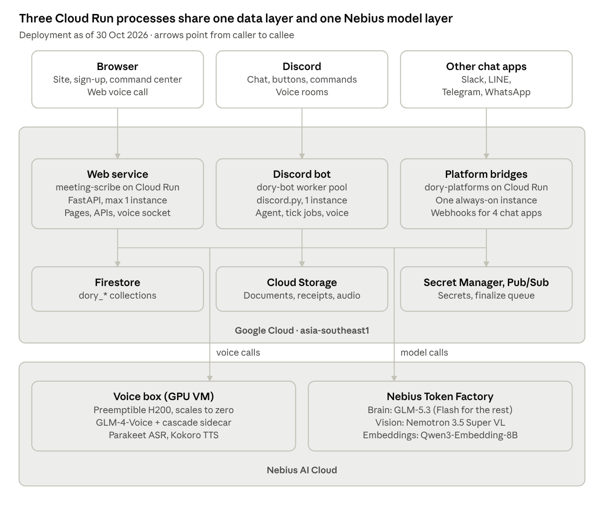
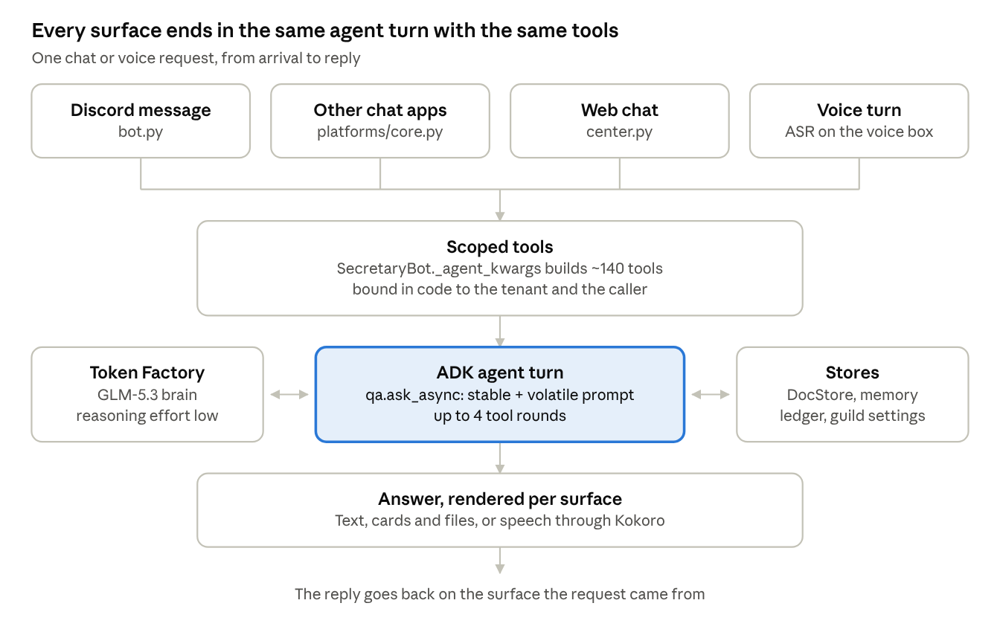

# Dory — Tech Stack & Architecture

As of 30 Oct 2026 (`main` at `d8a0db5`). Living copy for comments: https://claude.ai/artifact/XNMwitn6v6fr1dMHPyiUzi

## Overview

Dory is an AI coworker for teams: one Python codebase runs a Discord bot, chat bridges for Slack, LINE, Telegram and WhatsApp, and a FastAPI web command center, all sharing one store and one agent "brain". Text, vision and embeddings run on Nebius Token Factory; voice runs on a self-hosted GPU box on Nebius; Google Cloud hosts the web service, the bot and the data.

The repo ships two Python packages from one `pyproject.toml`:

- `src/meeting_scribe/` (19 modules): the FastAPI web service. Public site `/`, sign-up `/start`, command center `/center`, admin hub `/hub`, PM dashboard `/pm`, and the original Meeting Scribe recorder `/recorder`.
- `src/dory/` (198 modules + 18 in `platforms/`): the bot and every feature. Feature logic lives in pure modules; Discord glue lives in thin `*_bot.py` mixins.

Size as of this scan: about 113,000 lines of Python in `src/`, and 4,846 offline test functions in 203 test files.

Runtime pieces:

| Piece | What it runs | Where |
| --- | --- | --- |
| Web service `meeting-scribe` | `uvicorn meeting_scribe.app:app` (site, command center, APIs, web voice socket) | Cloud Run service, max 1 instance |
| Discord bot `dory-bot` | `python -m dory` (gateway connection, no HTTP port) | Cloud Run worker pool, 1 instance |
| Platform bridges | `python -m dory.platforms` (Slack, LINE, Telegram, WhatsApp) | Cloud Run service `dory-platforms` (script ready; live status not checked) |
| Voice box | GLM-4-Voice + cascade sidecar (ASR, Dory's brain, TTS) | Nebius GPU VM (preemptible H200), scales to zero |
| Models | GLM-5.3 brain, Nemotron VL vision, Qwen3 embeddings | Nebius Token Factory (OpenAI-compatible API) |
| Data | `dory_*` Firestore collections, two GCS buckets, Pub/Sub topic | GCP project `dory-personal-assistant`, asia-southeast1 |

## Tech stack

Python 3.12 end to end, managed with uv; the web front end is plain HTML, CSS and JavaScript with no build step. Versions below are the ones pinned in `uv.lock`.

| Layer | Technology | Version | Used for |
| --- | --- | --- | --- |
| Language / tooling | Python, uv, ruff | 3.12, uv 0.10.11 | Runtime, dependency lock, lint + format (line length 100) |
| Web framework | FastAPI + uvicorn | 0.141.1 / 0.54.0 | Web service, REST APIs, WebSocket voice |
| Settings / models | pydantic, pydantic-settings | 2.14.0 | Typed config (`DORY_*` env), request and record models |
| Agent framework | Google ADK (`LlmAgent`, `InMemoryRunner`) | 2.11.0 | Dory's tool-calling agent (~140 tools) |
| Model client | LiteLLM (inside ADK), google-genai, httpx | 1.106.4 / 2.29.0 / 0.28 | Token Factory (OpenAI API), Gemini, all HTTP calls |
| Chat platforms | discord.py[voice] + voice-recv, slack-bolt, line-bot-sdk | 2.7.1 / 1.30.0 / 3.26.0 | Discord bot + voice rooms, Slack, LINE (Telegram, WhatsApp over plain HTTP) |
| Cloud SDKs | google-cloud-firestore, -storage, -pubsub; nebius | 2.34.1 / 3.17 / 2.42.0; 0.6.28 | Data, files, finalize queue; starting the GPU VM |
| Data analysis | DuckDB, pandas, openpyxl, xlrd | 1.5.6 / 3.0 | In-memory SQL over uploaded Excel / CSV |
| Documents | fpdf2, python-docx, python-pptx, pypdf | 2.8 / 1.2 / 1.0 / 6.20 | PDF reports, Word exports, slide decks, PDF reading |
| Images / text | Pillow + raqm (libfribidi), uharfbuzz, matplotlib | 12.3 / 0.56 / 3.11 | Thai-correct image cards, charts |
| Other | mcp, ffmpeg, Gemini CLI (Node, pinned 0.64.0) | 2.3 | MCP tools; audio conversion; executive "deep tasks" |
| Front end | Vanilla HTML / CSS / JS, one design system `static/dory/theme.css` | — | 8 pages; Google Identity Services, mammoth and SheetJS loaded on demand |
| Containers | Docker, `python:3.12-slim-bookworm` | — | `Dockerfile` (web), `Dockerfile.dory` (bot: adds Node, opus, Thai/CJK fonts) |
| Testing | pytest, pytest-asyncio, Playwright + axe | 9.1 | Offline unit tests, browser smoke + WCAG 2.2 AA scans |
| Voice box | GLM-4-Voice, Parakeet-TDT (NeMo), Whisper, Kokoro-82M | — | Self-hosted speech to speech on the Nebius GPU VM (`deploy/glm_voice/`) |

## Deployment architecture

Three processes on Google Cloud Run (GCP project `dory-personal-assistant`) share one Firestore and call Nebius for every model and for voice.



Each chat surface reaches exactly one process; all three read and write the same store, so a person sees the same tasks and memory everywhere. The web service and the Discord bot also open voice calls to the GPU box, which Dory starts on demand and stops when idle. The web service runs with max-instances = 1 on purpose: some locks and caches are per process.

## AI and model layer

Every model call goes through one client, `llm.make_client`. When `DORY_NEBIUS_API_KEY` is set it returns a `RoutedClient` that sends text and image calls to Nebius Token Factory and everything else to Gemini. In the production project (`dory-personal-assistant`) the Vertex AI API is off by the owner's decision, so the Gemini-only features (audio transcription, Gemini TTS, PDF bytes in chat, image generation, Google-grounded search) are unavailable there.

| Job | Model | Setting | Notes |
| --- | --- | --- | --- |
| Agent brain (chat + voice answers, tool calls) | `zai-org/GLM-5.3` | `DORY_BRAIN_MODEL`, effort `DORY_BRAIN_EFFORT` = low | Via ADK `LiteLlm`; reasoning on, max 4 tool rounds |
| Every other text call (summaries, gates, extraction) | `zai-org/GLM-5.3-Flash` | `DORY_FAST_MODEL` | About one tenth of the brain's price |
| Anything with an image (receipts, photos) | `nvidia/Nemotron-3.5-Super-VL` | `DORY_NEMOTRON_VISION_MODEL` | Reasoning must stay off (else empty JSON) |
| Embeddings for memory search | `Qwen/Qwen3-Embedding-8B` | `DORY_NEBIUS_EMBED_MODEL`, 256 dims | Hybrid keyword + vector search (RRF) |
| Web search | Tavily, else Gemini grounding | `DORY_TAVILY_API_KEY` | Tavily is the path with no Google |
| Executive deep tasks | Gemini CLI, `gemini-3-flash-preview` | `DORY_GEMINI_CLI_PATH` | Headless, isolated temp HOME, pinned model |
| Gemini fallbacks (needs Vertex) | `gemini-3.5-flash`, `-flash-lite`, `gemini-2.5-flash-tts`, Nano Banana, Gemini Live | `DORY_GEMINI_*` and others | Off in the Nebius project |

How the agent is built (`qa.py`):

- An ADK `LlmAgent` with an `InMemoryRunner` per request. Tools are built per request and bound in code to the caller's guild and user, so neither appears in a tool schema the model can change.
- All feature tools are appended in ONE list in `SecretaryBot._agent_kwargs`, so typed chat, Discord voice rooms and the web voice call share the same tools.
- The system prompt = `stable_prompt` (kept identical and first, so Token Factory's automatic prefix cache applies) + `volatile_prompt` (time, caller, company data).
- Cost is logged per call (`token factory <model> prompt= cached= completion=`) and per answer.

Voice (two paths, one brain):

1. Web call and Discord rooms with `DORY_VOICE_MODE=glm` connect to the voice box over a WebSocket (`glm_voice.py`).
2. The cascade sidecar (port 8766) transcribes with Parakeet-TDT 0.6B (Whisper for Thai), sends the text to Dory's normal brain with tools, and speaks the answer with Kokoro-82M sentence by sentence. Port 8765 is plain GLM-4-Voice small talk with no tools.
3. Without `DORY_GLM_VOICE_URL` the web call falls back to Gemini Live (needs Vertex).

## Data and storage

All processes must point at the same store: Firestore in production, one SQLite file locally (`DORY_STORE`, `DORY_DB_PATH`). A second process with its own SQLite file sees an empty company.

Storage layers:

| Layer | Implementation | Holds |
| --- | --- | --- |
| Ledger store (`store.py`) | `SQLiteStore` / `FirestoreStore` | Receipts and expenses, doc id `{guild_id}_{sha256}`, dedupe per tenant |
| DocStore (`coo_store.py`) | `SQLiteDocStore` / `FirestoreDocStore`, one key-value API with transactions | Most feature data: tasks, projects, people, wiki, reminders, trips, votes, jobs, monitor log, rate limits… one `dory_<kind>` collection per kind |
| Org store (`orgs.py`) | `OrgStore` on the DocStore | Orgs, members, identities, invites, workspaces, positions |
| Guild settings (`guild_settings.py`) | Firestore `dory_guilds` / SQLite table / in-memory | Per-server features, channels, languages, tone, admin emails (60 s cache, fail-open) |
| Team memory (`memory_store.py`, `firestore_memory.py`) | Raw message log + daily summaries with vectors | What people said, summarised per channel per day; kept forever by default |
| Memory index (`memory_index.py`) | In-process LRU cache, 64 MB | Summaries + vectors per tenant; assumes one bot process |
| Files | GCS `dory-personal-assistant-files`, `-audio` | Original documents and receipts, recorder audio |

Multi-tenancy and access rules:

- Tenant key = a workspace memory id (`orgs.workspace_memory_id`): a Discord guild id, or a namespaced id for Slack, LINE, Telegram, WhatsApp and the web. Every read starts with the tenant id.
- An org groups several workspaces; a person is one `orgs.Member` with verified platform identities.
- Memory scope is fail-closed: an answer only uses channels both the asker and everyone reading the answer can read (`memory_access.py`).
- Firestore queries use equality filters only (no composite indexes); ranges and sorting happen in Python. This fits shop-sized tenants.
- Rate limits, sign-up dedupe, link-code guessing limits and the finalize lock live in the store, so a restart keeps them.

## Key request flows

A chat message, a web question and a voice turn all become the same agent turn with the same tool list, so a feature written once works on every surface.



Background pipelines that run outside a request:

1. **Team memory.** Every message the bot sees is logged; `MemoryScheduler` batches them into daily summaries with embeddings. Each batch then feeds `TaskTracker` (action items become tasks with Accept / Edit / Decline cards), `ProjectListener` (project status heard in chat) and `PeopleListener` (who does what).
2. **Tick jobs.** The bot's loop runs reminders (every 30 s), task nudges, briefings, market alerts, votes and the change outbox.
3. **Change outbox.** An org edit on the website is written once to `dory_change_outbox`, then delivered to every connected workspace and person, resent every 15 min until acknowledged (8 tries max).
4. **Meeting Scribe recorder.** The browser uploads ~45 s audio chunks to `/api/meetings/{id}/chunks`; ffmpeg makes 16 kHz FLAC, Gemini transcribes with speaker labels. On Stop, Pub/Sub triggers `/pubsub/finalize`, an ADK multi-agent summarizer writes decisions and action items to Firestore and posts to Discord. This path needs Vertex Gemini.
5. **Workflow monitor (behind a flag).** Video ads, deep tasks, research and outbox items emit events to `dory_monitor_log`; the bot writes a heartbeat every 30 s; `/center#/monitor` shows them.

## Integrations

Dory talks to 6 chat surfaces and about a dozen outside services. Feature logic never calls a platform API directly: it goes through the `Workspace` interface (`workspace.py`), and a platform that lacks a capability declares it, so the tool is left out.

| Service | Purpose | How | Code |
| --- | --- | --- | --- |
| Discord | Main home: chat, buttons, slash commands, voice rooms | Gateway (discord.py), REST v10, OAuth sign-in | `bot.py`, `meeting.py`, `*_bot.py` mixins |
| Slack | Chat, history import, email-based identity match | slack-bolt, Web API | `platforms/slack.py`, `workspace_slack.py` |
| LINE | Chat bot | line-bot-sdk webhooks | `platforms/line.py` |
| Telegram | Chat bot | Bot API over HTTP | `platforms/telegram.py` |
| WhatsApp | Chat bot | Meta Graph API | `platforms/whatsapp.py` |
| ClickUp | Task import | REST API | `connectors/clickup.py` |
| Nebius Token Factory | All text, vision and embedding models | OpenAI-compatible API | `llm.py`, `embed.py` |
| Nebius Compute | Start the GPU voice VM on demand | `nebius` Python SDK | `nebius_vm.py` |
| Google sign-in | Web accounts | Google Identity Services ID tokens | `hub.py` |
| Google Calendar | Per-member calendar overlay, free / busy, Meet | OAuth (PKCE), Calendar API v3 | `google_oauth.py`, `scheduling.py` |
| Google Maps Platform, Gmail, Safe Browsing | Places, routes, weather, sending email, link checks | REST APIs | various tool modules |
| Duffel, LiteAPI | Flight and hotel search + sandbox booking | REST (test environments, no money) | `trips.py` |
| Amadeus Self-Service | Older travel provider, still in code | REST test environment | `trips.py` |
| Open-Meteo | Weather forecast cards | Public REST, no key | weather tool |
| Tavily | Web search without Google | REST | search tools |
| Yahoo Finance, Google News RSS, Gold Traders Association | Stocks, news, Thai gold price | Public endpoints, cached | `markets.py` |

When a travel provider fails or returns nothing, `trips.py` serves a deterministic sample instead; `DORY_TRAVEL_PROVIDER=sample` forces it.

## Security and access

Access is decided in code, never by the model: tools are bound to the caller's tenant and user when the request is built, and every permission check runs server-side.

- **Web sign-in.** Google ID token (checked against `HUB_GOOGLE_CLIENT_ID`) or "Sign in with Discord" (OAuth `identify email`, verified email required). Either is exchanged for a Dory session `ss1.<payload>.<hmac>` (HMAC-SHA256 with `DORY_SESSION_SECRET`, 30 days) kept in the browser's localStorage.
- **Linking platforms.** A Discord server joins an org with a one-time `/setup` code; a person links LINE, Telegram, WhatsApp or Slack with an 8-digit code (15 min, single use, redeemed only in a 1:1 chat, guess-limited in the store).
- **Roles.** One owner per org; ownership is only handed over to an existing member (undo within 24 h). Admins manage members; a member's own role only goes down.
- **Licence gate.** An unlinked or unlicensed Discord server gets every feature switched off except `/setup`.
- **Data scope.** Memory, wiki, people and datasets are shown only when the reader can read every source channel; unknown audiences fall back to that room's own memory.
- **Prompt safety.** Company rules taught to Dory pass `injection_reason`, which refuses items touching permissions, secrets or her persona; bookings and destructive actions need a two-step confirm.
- **Secrets.** Kept in GCP Secret Manager (`dory-discord-token`, `dory-nebius-api-key`, `dory-session-secret`, `dory-discord-client-secret`) and mounted as env vars; deploy scripts read values from `.env` over stdin and never echo them. CI runs a gitleaks secret scan on every push.
- **Pub/Sub push.** `/pubsub/finalize` verifies the push's OIDC token.
- **Known gap.** The Meeting Scribe recorder (`/recorder`) and its API have no auth; keep that URL private.

## Dev workflow

Work happens on a feature branch with a failing offline test first; `main` changes only through a reviewed PR, and deploys need a human's approval.

Repo layout:

| Path | What is there |
| --- | --- |
| `src/meeting_scribe/` | FastAPI app (`app.py`), command center API (`center.py`), hub, PM and monitor APIs, `static/` pages |
| `src/dory/` | Bot, agent, every feature (pure module + `*_bot.py` mixin), stores, i18n catalog and `locales/` |
| `src/dory/platforms/` | Slack, LINE, Telegram, WhatsApp bridges and their shared `core.py` |
| `deploy/glm_voice/` | Voice box: `server.py`, `cascade.py`, `install.sh`, `vm.sh` (Nebius CLI) |
| `tests/`, `tests/dory/`, `tests/e2e/` | Offline unit tests (fake Firestore, scripted ADK model), Playwright browser tests |
| `scripts/` | Deploy scripts, migrations, probes, sample generators |
| `docs/` | Feature specs (`superpowers/specs`), platform setup, voice behaviour, research notes, this file |
| `CLAUDE.md` | The living code map and rules for people and AI agents; read it first |

Daily commands:

```bash
uv sync                                          # install from uv.lock
uv run pytest -q                                 # offline suite; live and e2e tests are deselected
uvx ruff check . && uvx ruff format --check .    # lint + format
STORE=memory uv run uvicorn meeting_scribe.app:app --port 8080
```

CI (`.github/workflows/ci.yml`, on GitHub Actions, Ubuntu 24.04) runs four jobs: ruff lint, the offline pytest suite, the Playwright e2e smoke + axe WCAG 2.2 AA scan, and a gitleaks secret scan.

Deploying (dry run by default; `--apply` only with approval):

| Script | Deploys |
| --- | --- |
| `scripts/deploy.sh` | Web service `meeting-scribe` on Cloud Run, plus IAM, secrets, buckets, Firestore, Pub/Sub on a fresh project; updates env vars instead of replacing them |
| `scripts/deploy_dory.sh` | Discord bot as the `dory-bot` worker pool (Cloud Build with `Dockerfile.dory`) |
| `scripts/deploy_platforms.sh` | Platform bridges as the `dory-platforms` Cloud Run service |
| `deploy/glm_voice/vm.sh` | Creates, provisions, starts and stops the GPU voice VM |

Conventions: code, comments, docs and UI in English; every user-facing string in `i18n.py` in Thai and English; new features written once for every platform; no `pip install` (use `uv add`); never print or commit `.env` values.
